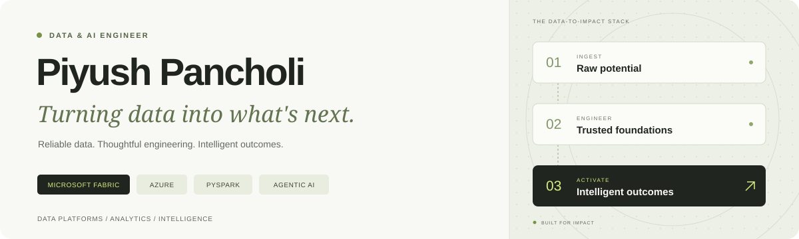

<p align="center">
  
</p>

<p align="center">
  <strong>Reliable data. Thoughtful engineering. Intelligent outcomes.</strong>
</p>

<p align="center">
  <a href="https://www.linkedin.com/in/piyush-pancholi-09b827206/">LinkedIn</a>
  &nbsp;&middot;&nbsp;
  <a href="mailto:pancholipiyush08@gmail.com">Say hello</a>
  &nbsp;&middot;&nbsp;
  <a href="https://github.com/08piyush?tab=repositories">Explore my repositories</a>
</p>

---

### A little about me

I'm **Piyush**, a Data & AI Engineer at **MAQ Software** and a Computer Science graduate from **IIT Bhilai**.

I build on **Microsoft Fabric and Azure**, connecting the dots between raw data, trusted analytics, and useful AI. My work spans PySpark pipelines, lakehouse architecture, dimensional modeling, and agents that make analytics more accessible.

```text
Raw signals  -->  Trusted lakehouses  -->  Business context  -->  Intelligent action
                  Bronze / Silver / Gold                       Analytics + Agents
```

### Where I make an impact

| Data platforms | Agentic analytics | Quality & automation |
| :--- | :--- | :--- |
| Near-real-time telemetry ingestion from **10+ regional Kusto clusters** into Fabric Medallion layers. | A Copilot Studio orchestrator routing analytics across **10 Fabric Data Agents**. | A metadata-driven framework with **30+ data quality checks** and real-time failure tracking. |
| Up to **10x faster** critical pipeline processing. | Serving **800 users**, with scope controls and an evaluation harness. | **4+ hours saved** per pipeline cycle. |

<sub>Selected professional work at MAQ Software, summarized from my resume; not public project repositories.</sub>

### My engineering toolkit

| Area | Tools & concepts |
| :--- | :--- |
| **Languages & processing** | Python, SQL, PySpark, Apache Spark, C/C++ |
| **Data platforms** | Microsoft Fabric, Azure Synapse, Databricks, Delta Lake |
| **Architecture & modeling** | Medallion architecture, lakehouse, dimensional modeling, SCD Type 1/2 |
| **Pipelines & quality** | Metadata-driven ETL, event-driven pipelines, data quality, performance tuning |
| **Databases & BI** | Kusto / ADX, PostgreSQL, SQL Server, MongoDB, Power BI |
| **Agents & AI** | Copilot Studio, Fabric Data Agents, Fabric IQ, ontologies, agent evaluation |
| **Delivery** | Git, REST APIs, PowerShell, spec-driven development, harness engineering |

### What I bring to a team

- **End-to-end thinking:** ingestion, transformation, modeling, validation, and consumption.
- **Trust by design:** data contracts, governed models, measurable quality, and explicit agent boundaries.
- **A builder's mindset:** automate repeatable work and measure what actually improves.

### Foundations & milestones

**B.Tech. in Computer Science & Engineering** &middot; IIT Bhilai &middot; 2020-2024 &middot; **8.6 / 10 CGPA**

<details>
  <summary><strong>Certifications</strong></summary>

- **DP-600** &mdash; Microsoft Certified: Fabric Analytics Engineer Associate
- **DP-700** &mdash; Microsoft Certified: Fabric Data Engineer Associate
- **DP-800** &mdash; Microsoft Certified: SQL AI Developer Associate
- **AB-620** &mdash; Microsoft Certified: AI Agent Builder Associate
- **GH-300** &mdash; GitHub Copilot Certification

</details>

<details>
  <summary><strong>Beyond the code</strong></summary>

- **Gayatri Devi Leadership Gold Medal**, IIT Bhilai (2024)
- **All India Rank 549**, Google HashCode (2022)
- **Mentor (2024) & Coordinator (2023)**, Centre for Career Planning and Services, IIT Bhilai
- Previously a **Software Development Intern at Pataa Navigations**, building similarity-ranked search and geospatial features.

</details>

---

<p align="center">
  <strong>Have an interesting data challenge or an idea to explore?</strong><br>
  <a href="mailto:pancholipiyush08@gmail.com">Let's turn it into something useful.</a>
</p>
